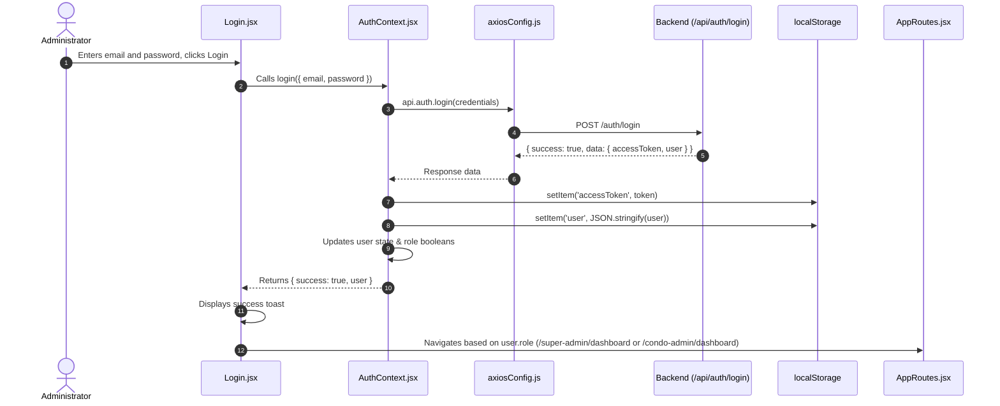

# Authentication & Authorization

This document details the authentication and authorization mechanism implemented in the React frontend.

---

## 1. Authentication Strategy

- **Token Type**: Bearer JWT (JSON Web Token).
- **Storage**: Browser `localStorage` keys:
  - `'accessToken'`: String JWT token.
  - `'user'`: Serialized JSON string containing user details `{ id, fullName, email, role, condoId, condoCode }`.
- **HTTP Transport**: Automatically attached via Axios request interceptor as `Authorization: Bearer <accessToken>`.
- **Session Expiration / Invalidation**: 401 response interceptor in Axios triggers automatic localStorage cleanup and redirects to `/login`.

---

## 2. Login Flow (`/login`)



---

## 3. Logout Flow

1. Triggered from sidebar footer button in [`Sidebar.jsx`](file:///c:/Users/hp/OneDrive/Desktop/insa_projects/CMS/react/src/components/common/Sidebar.jsx).
2. Calls `logout()` from `AuthContext`:
   ```javascript
   const logout = () => {
     localStorage.removeItem('accessToken');
     localStorage.removeItem('user');
     setUser(null);
     setIsSuperAdmin(false);
     setIsCondoAdmin(false);
     setIsResident(false);
     setIsGuard(false);
   };
   ```
3. Navigates user to `/login`.

---

## 4. Role Hierarchy & Access Boundaries

| Role Code | Accessible Consoles | Navigation Links |
|---|---|---|
| `super_admin` | Super Admin Console (`/super-admin/*`) | Dashboard, Condos, Users, Reports, Payments, Announcements, Promotions, Equb & Iddir. |
| `condo_admin` | Condo Admin Console (`/condo-admin/*`) | Dashboard, Residents, Reports, Payments, Lost & Found, Announcements, Equbs, Iddirs. |
| `resident` / `guard` | None (Web console redirects to `/login` or placeholder) | N/A |
