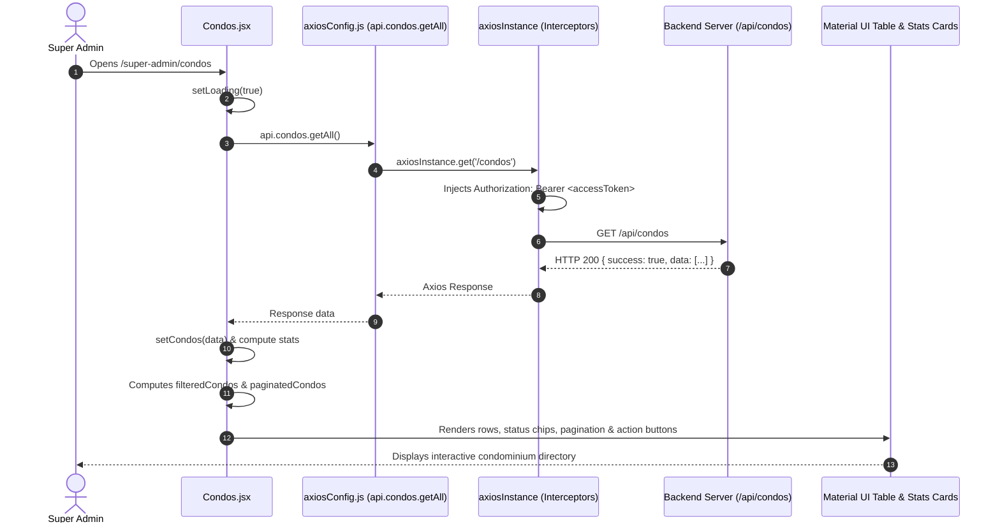
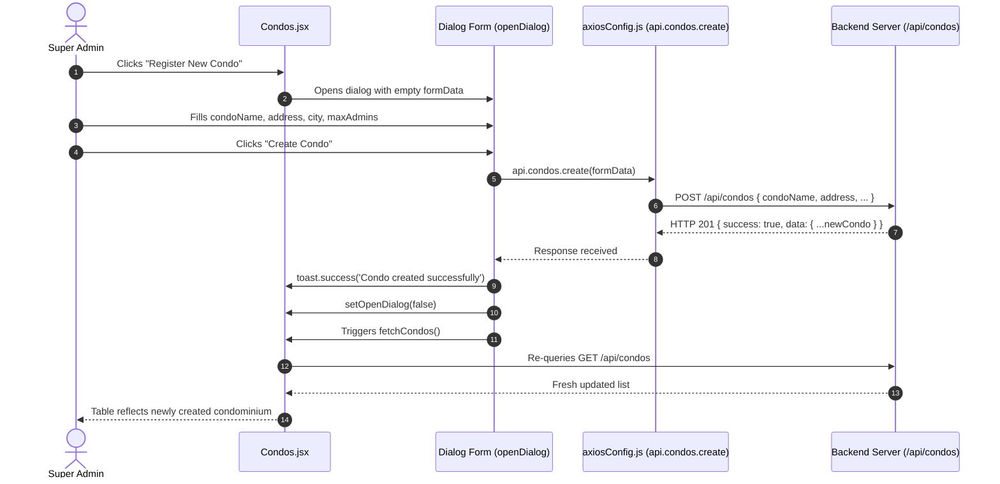

# Data Flow Architecture

This document maps how data travels through the React frontend during fetching, mutation, and state synchronization.

---

## 1. Standard Page Query Flow (Example: Super Admin Condos)



---

## 2. Entity Creation & Mutation Flow (Example: Registering a Condo)



---

## 3. Direct Fetch Mutation Flow (Example: RegisterUserModal)

In [`src/components/user/RegisterUserModal.jsx`](file:///c:/Users/hp/OneDrive/Desktop/insa_projects/CMS/react/src/components/user/RegisterUserModal.jsx), user registration makes a direct `fetch()` call to the backend registration endpoint:

```
User submits form
  ↓
RegisterUserModal validates fields (fullName, email, password, phone, fan, condoCode)
  ↓
fetch('https://backend-a3xi.onrender.com/api/auth/register', { method: 'POST', body })
  ↓
Server creates resident account
  ↓
toast.success('User registered successfully!')
  ↓
onSuccess() callback invoked
  ↓
Parent (Users.jsx) re-fetches user roster via api.users.getAll()
  ↓
Modal closes
```
